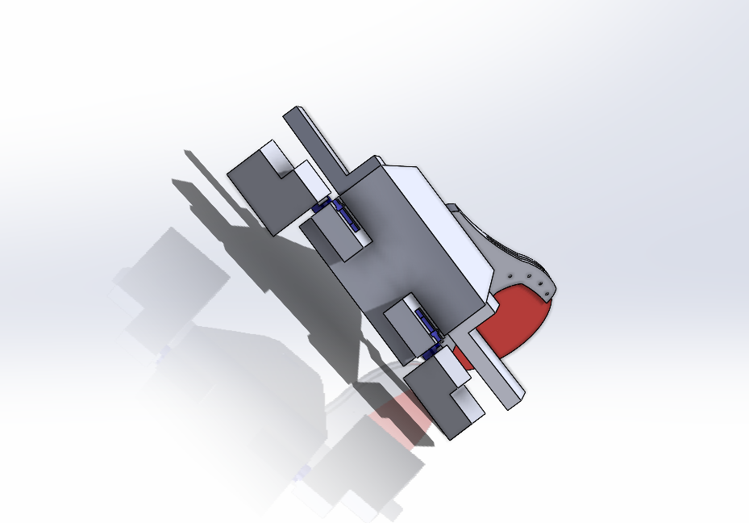
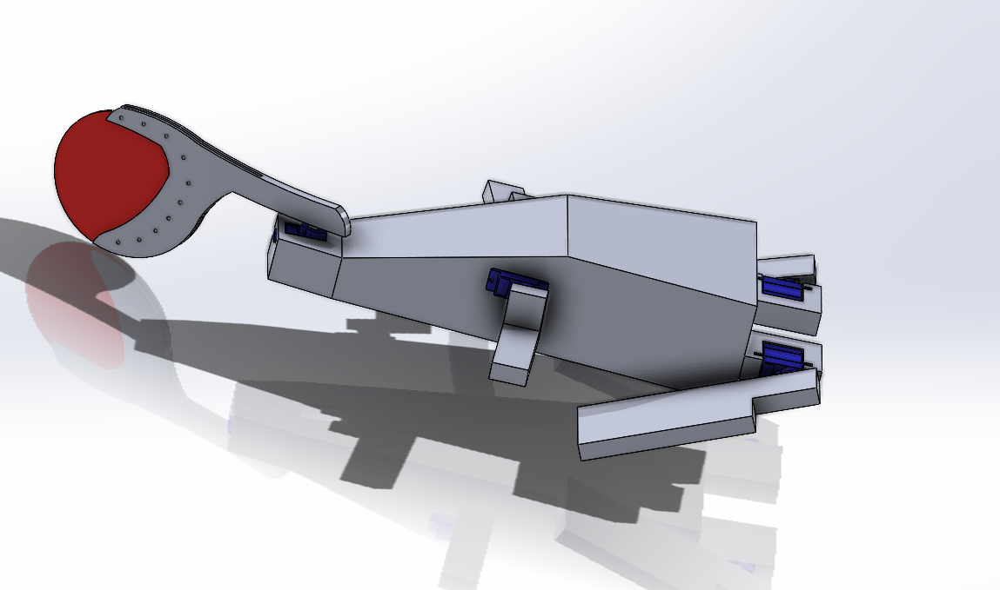
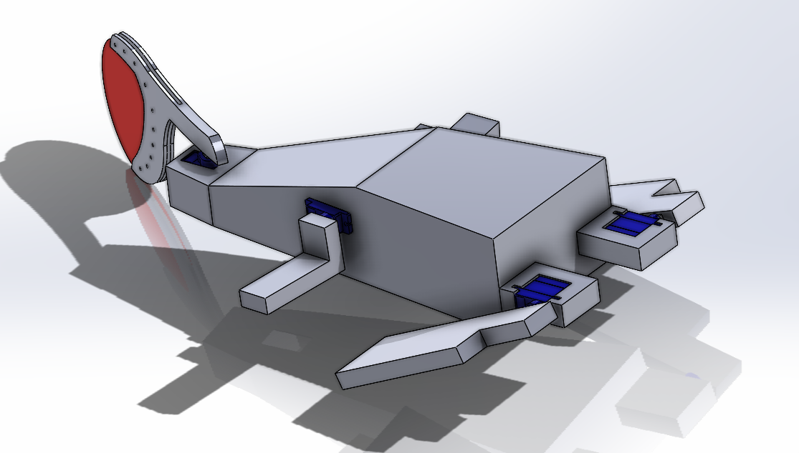
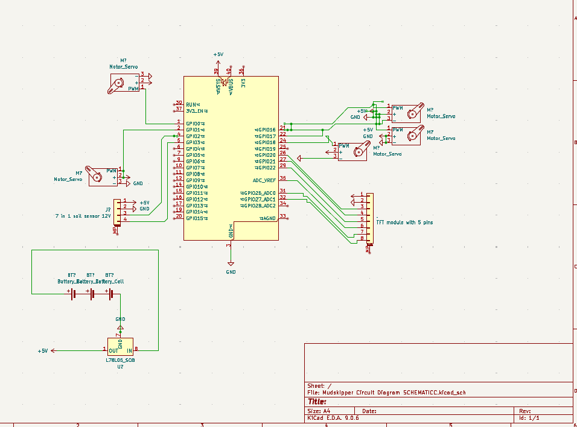
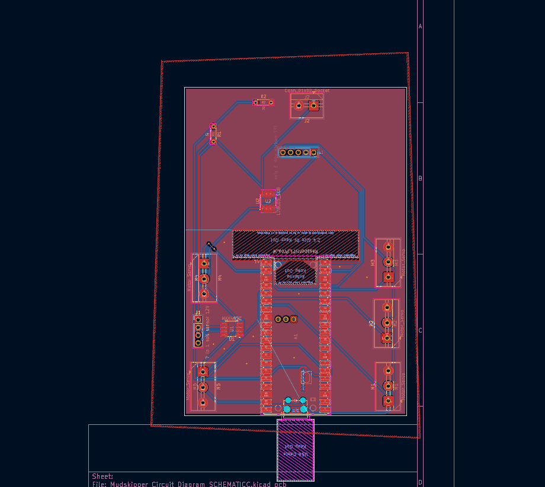

# TerraSkipper: early design

This is one of the early designs for TerraSkipper, a mudskipper-inspired robot for agriculture. I wanted to explore using fins and a tail to move across difficult ground, with a mechanism that lowers probes to take soil measurements.

The design also explored a seed-dropping mechanism. This repo keeps the CAD, circuit files, and early control logic from that stage. The later build is in [TerraSkipper V2](https://github.com/ZIZO932/Terraskipper-V2).

## Why I started it

I was interested in how mudskippers move through places where wheels can struggle. That gave me a starting point for a robot aimed at soil monitoring in the Nile Delta.

A lot of the work was figuring out how the idea would fit into a physical body: room for the electronics, servo mounts, enough wall thickness for printing, and a slider that could lower the probes. I also had to rethink the sensors after realizing that the first ones I looked at were meant for water.

## Mechanical design

The body is hollow to make room for the controller and wiring. Servo holders support the fins and tail, and the vertical slider is intended to place the probes against the soil.

## Electronics

I used KiCad to work through the controller, servo, sensor, and power connections. Moving from a breadboard layout to a schematic made it easier to track the connections and plan the PCB.

## Code in this repo

[code logic.py](code%20logic.py) is a conceptual simulation. It prints servo movements and uses example sensor readings to show the movement and measurement sequence. It doesn't control real hardware or collect live soil data.

## Parts estimate

These are the costs recorded for this design stage, rather than current supplier prices. The sensor listing and supplier links are kept from the original parts list.

| Item | Description | Qty | Unit Price (EGP) | Unit Price (USD) | Total Price (USD) | URL | Running Total (USD) |
|------|-------------|-----|------------------|------------------|-------------------|-----|---------------------|
| Raspberry Pi Pico W | MCU (Main Controller) | 1 | 650 | 13.85 | 13.85 | https://electra.store/product/raspberry-pi-pico-w/ | 13.85 |
| MG996R Servo | High Torque Servo Motor | 5 | 200 | 4.26 | 21.30 | https://www.ram-e-shop.com/ar/shop/servo-mg996-180-mg996r-servo-motor-180deg-11-kg-cm-metal-gears-7397?srsltid=AfmBOoq1zvLpgjLLOmXDFrNQpmj2SQrDjgcnsE8VNdSKkgjMb-rjCr2f | 35.15 |
| 7 in 1 soil sensor | pH and TDS Measurement Sensor | 1 | 4500 | 95.87 | 95.87 | https://makerselectronics.com/product/industrial-soil-moisture-temperature-sensor-modbus-rtu-rs485/?campaignid=20503411856&adgroid=up&network=x&device=c&campaignname=sales_pmax&gad_source=1&gad_campaignid=20503433012&gbraid=0AAAAApRJSNFn77HI4O79RMkhUNGKsHWNO&gclid=Cj0KCQiAyvHLBhDlARIsAHxl6xqx909JpmEgYe0-mFSB0og0OA0A5Ajb2pms3LxBvvR7rJVYkLQwEe4aAsfdEALw_wcB | 131.02 |
| Breadboard & Wires | Prototyping Accessories | 1 | 300 | 6.39 | 6.39 | https://www.ram-e-shop.com/shop/bb2t4d-j140-bb-bb-2t4d-j140-breadboard-1660-tie-point-140-jumper-wire-metal-base-6755 | 137.41 |
| XL4015 Converter | Regulation Module | 1 | 95 | 2.02 | 2.02 | https://www.ram-e-shop.com/shop/dc-dc-101-dc-dc-step-down-voltage-converter-adjustable-5a-xl4015-5v-32vdc-to-0-8v-30vdc-sku-dc101-7258 | 139.43 |
| 18650 Battery | Power Source | 2 | 245 | 5.22 | 10.44 | https://www.ram-e-shop.com/shop/battery-18650-lgcm-battery-lithium-li-ion-inr18650mh1-mh1-3200mah-10a-4-2-3-7-2-5v-rechargeable-9064 | 149.87 |
| MPU-6050 | IMU | 1 | 175 | 3.73 | 3.73 | https://www.ram-e-shop.com/shop/kit-imu-mpu6050-gy521-imu-6-dof-mpu-6050-gyroscope-accelerometer-sensor-module-7076 | 153.60 |
| NEO-6M GPS | GPS Module | 1 | 563 | 12.00 | 12.00 | https://makerselectronics.com/product/ublox-hw-539-neo-6m-gps-module/?srsltid=AfmBOorZ5a90If9bXw3bXueIRVRr6BAAfuh6hryrSHD4mv6YlEpa6hi- | 165.60 |

## Files

- [CAD](CAD/) — SolidWorks assembly and STEP model
- [KiCad schematic](Mudskipper%20Circuit%20Diagram%20SCHEMATICC.kicad_sch)
- [KiCad PCB](Mudskipper%20Circuit%20Diagram%20SCHEMATICC.kicad_pcb)
- [BOM](BOM.csv)
- [Build journal](journal.md)
- [Images](Images/)

The servo-driven prototype is documented in [Mudskipper](https://github.com/ZIZO932/Mudskipper), and the later DC-motor version is in [TerraSkipper V2](https://github.com/ZIZO932/Terraskipper-V2).
